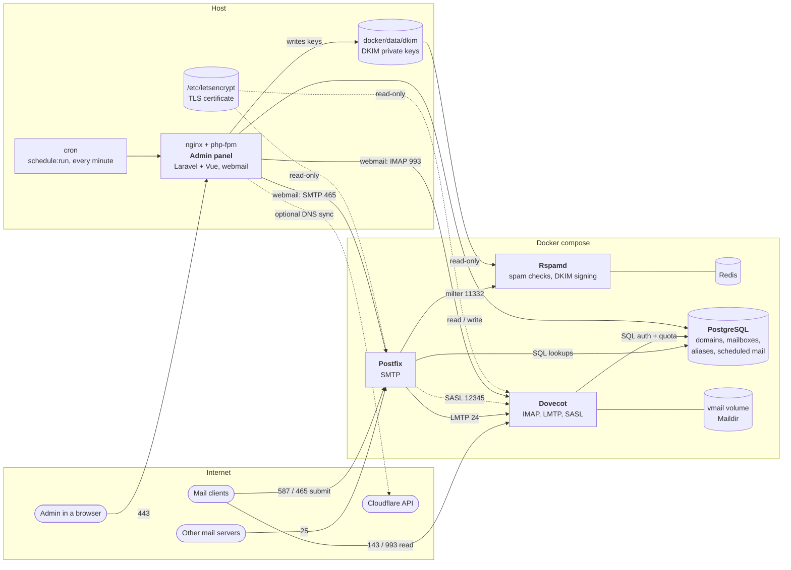

# Mail Server

Self-hosted mail server with a web admin panel and webmail.

- **Postfix** (SMTP), **Dovecot** (IMAP, LMTP, SASL) and **Rspamd** (antispam, DKIM signing) run in Docker.
- **PostgreSQL** holds domains, mailboxes, aliases, password hashes and quotas. Postfix and Dovecot read it directly.
- **Admin panel** (Laravel 13, Vue 3, Inertia) runs on the host next to nginx and php-fpm. It manages the data above and includes webmail, drafts, scheduled sending and analytics.

## Features

- Domains, mailboxes and aliases (including catch-all) with per-mailbox quota.
- Automatic DKIM key generation per domain, optional DNS sync through Cloudflare.
- Webmail: threads, search, folders, drag and drop, Cc/Bcc, rich text, attachments, inline images, drafts with autosave, an "All mail" view and scheduled sending.
- Admin shortcut that opens any mailbox's webmail without its password (Dovecot master user).
- Dashboard, analytics and CSV reports (domains, mailboxes, scheduled mail).
- Login by email and password, optional "Sign in with Google" for existing admin accounts.
- Responsive layout for phones.

## Architecture



| Part | Role |
|---|---|
| **Postfix** | Accepts mail on 25, takes authenticated submission on 587 and 465, looks up domains, mailboxes and aliases in Postgres, passes every message through Rspamd and delivers accepted mail to Dovecot over LMTP. |
| **Rspamd** | Antispam milter. Signs outgoing mail with the per-domain DKIM keys. Uses Redis for its state. |
| **Dovecot** | IMAP on 143 and 993, LMTP delivery into Maildir, SASL login for Postfix and per-mailbox quota from Postgres. |
| **PostgreSQL** | Single source of truth for all mail routing data and the panel's own tables. Published on loopback only. |
| **Admin panel** | Laravel and Vue (Inertia) on the host. Manages everything above, plus webmail, drafts, scheduled sending and analytics. The only component that writes to Postgres. |
| **certbot** | Runs on the host and issues the one certificate that Postfix and Dovecot mount read-only. |

The admin panel runs outside Docker and reaches Postgres on `127.0.0.1:5432` and Dovecot and Postfix on their published ports. TLS certificates come from the host's own certbot, and both containers mount `/etc/letsencrypt` read-only.

## Requirements

- A server with a public IP, a mail hostname with a valid DNS record and ports 25, 465, 587, 143 and 993 open
- Docker with the compose plugin
- PHP 8.4 or newer with `pdo_pgsql`, `mbstring`, `openssl`, `iconv`, plus Composer
- A recent Node.js LTS (only to build the frontend)
- nginx (or another web server) with php-fpm and certbot on the host

## First run

### 1. Mail stack

```bash
cp .env.example .env
# Set APP_DOMAIN, MAIL_DOMAIN, DB_PASSWORD and DOVECOT_MASTER_PASSWORD.
# Generate secrets with: openssl rand -base64 32 | tr -d '/+=' | cut -c1-32

# Get a certificate for APP_DOMAIN first (Postfix and Dovecot wait for it):
sudo certbot certonly --nginx -d mail.example.com

docker compose up -d --build
```

Postfix and Dovecot refuse to start while `DB_PASSWORD` or `DOVECOT_MASTER_PASSWORD` is empty or `change-me`.

### 2. Admin panel

```bash
cd admin
cp .env.example .env
# Set APP_URL, APP_DOMAIN, APP_ENV=production, APP_DEBUG=false, APP_TIMEZONE,
# the same DB_* and DOVECOT_MASTER_PASSWORD as the root .env,
# ADMIN_EMAIL and ADMIN_PASSWORD (at least 10 characters).
# Set SESSION_SECURE_COOKIE=true when served over HTTPS.

composer install --no-dev --optimize-autoloader
php artisan key:generate
php artisan migrate --force
php artisan db:seed --force      # creates the first admin from ADMIN_EMAIL / ADMIN_PASSWORD
npm ci && npm run build
```

Point nginx at `admin/public` with php-fpm, then open the site and log in. After the first login you can blank `ADMIN_PASSWORD` in `.env`.

### 3. Cron for scheduled mail

Scheduled messages are stored in the database and sent by Laravel's scheduler. Add this entry for the user that runs the panel:

```cron
* * * * * cd /path/to/admin && php artisan schedule:run >> /dev/null 2>&1
```

Without it, messages queued with "Send later" are never sent. A message is retried up to 3 times and then marked as failed.

### Adding mail

1. **Domains**: add `example.com`. A 2048-bit DKIM key is generated, the private key is written to `docker/data/dkim` (read by rspamd) and the public key is shown under "DNS".
2. **Mailboxes**: add `user@example.com` and a password. Postfix and Dovecot pick it up immediately.
3. **Aliases**: `info@example.com` to `user@example.com`, or `@example.com` as a catch-all.
4. **Webmail**: sign in with a mailbox's credentials, or use the inbox icon in the mailbox list.

## Environment variables

Two files, because two things read them. The root `.env` is for `docker-compose.yml` (Postgres, Postfix, Dovecot). `admin/.env` is for the Laravel panel on the host. Values marked "same" must be identical in both files.

### Root `.env`

| Variable | What it does |
|---|---|
| `APP_DOMAIN` | Mail hostname. Postfix banner, MX target and the certificate folder `/etc/letsencrypt/live/<APP_DOMAIN>/` used by Postfix and Dovecot. Same in `admin/.env`. |
| `MAIL_DOMAIN` | Postfix `mydomain` (default domain for local addresses). |
| `DB_DATABASE`, `DB_USERNAME`, `DB_PASSWORD` | Creates the Postgres database and user, and is what Postfix and Dovecot use for their SQL lookups. Same in `admin/.env`. |
| `DOVECOT_MASTER_PASSWORD` | Password of the Dovecot master user. Lets the panel open any mailbox in webmail and send scheduled mail without mailbox passwords. Same in `admin/.env`. |

### `admin/.env` – application

| Variable | What it does |
|---|---|
| `APP_NAME` | Application name (Laravel default, the browser title is set in the frontend). |
| `APP_ENV` | `local` or `production`. |
| `APP_KEY` | Encrypts sessions and the webmail credentials stored in the session. Create with `php artisan key:generate` and never change it on a live system without logging everyone out. |
| `APP_DEBUG` | Detailed error pages. Must be `false` in production. |
| `APP_URL` | Public URL of the panel. |
| `APP_TIMEZONE` | Time zone for dates in the UI, reports and CSV files. Default `UTC`. |
| `APP_LOCALE`, `APP_FALLBACK_LOCALE` | Laravel language settings. The UI itself is English only. |
| `APP_FAKER_LOCALE` | Only used by factories and tests. |
| `APP_MAINTENANCE_DRIVER` | Where `artisan down` keeps its state (`file`). |
| `BCRYPT_ROUNDS` | Cost of the admin password hash. |
| `LOG_CHANNEL`, `LOG_STACK`, `LOG_LEVEL`, `LOG_DEPRECATIONS_CHANNEL` | Logging. Logs go to `storage/logs/laravel.log`. |

### `admin/.env` – database and mail server

| Variable | What it does |
|---|---|
| `DB_CONNECTION`, `DB_HOST`, `DB_PORT` | Always `pgsql`, `127.0.0.1`, `5432` (Postgres is published on loopback). |
| `DB_DATABASE`, `DB_USERNAME`, `DB_PASSWORD` | Same as the root `.env`. |
| `APP_DOMAIN` | Same as the root `.env`. Used as the MX target when syncing DNS. |
| `DKIM_KEYS_PATH` | Where generated DKIM private keys are written. Must be the host path mounted into rspamd (`docker/data/dkim`, relative to `admin/`). |
| `MAIL_DEFAULT_QUOTA_MB` | Quota suggested for new mailboxes. |
| `IMAP_HOST`, `SMTP_HOST` | Where webmail connects (IMAP 993, SMTP 465). `127.0.0.1` because the panel runs on the same host. |
| `DOVECOT_MASTER_PASSWORD` | Same as the root `.env`. |
| `DOVECOT_MASTER_USER` | Optional, defaults to `admin`. Must match `docker/dovecot/master-users.template`. |

### `admin/.env` – access

| Variable | What it does |
|---|---|
| `ADMIN_EMAIL`, `ADMIN_PASSWORD` | Read by `php artisan db:seed` to create the first admin (password at least 10 characters). Can be blanked afterwards. |
| `GOOGLE_CLIENT_ID`, `GOOGLE_CLIENT_SECRET`, `GOOGLE_REDIRECT_URI` | Optional "Sign in with Google" for an existing admin with the same email. Empty means disabled. |
| `CLOUDFLARE_API_TOKEN` | Optional. Enables "Sync DNS" on the Domains page. |
| `SESSION_DRIVER`, `SESSION_LIFETIME`, `SESSION_ENCRYPT`, `SESSION_PATH`, `SESSION_DOMAIN` | Session storage (database), lifetime in minutes and cookie scope. |
| `SESSION_SECURE_COOKIE` | `true` when the panel is served over HTTPS. With `false` on HTTPS or `true` on plain HTTP login loops. |

### `admin/.env` – framework defaults

| Variable | What it does |
|---|---|
| `CACHE_STORE` | Cache backend (`database`). |
| `QUEUE_CONNECTION`, `FILESYSTEM_DISK` | Laravel defaults. The panel does not use queues or file storage, scheduled mail goes through its own `scheduled_emails` table. |
| `MAIL_MAILER`, `MAIL_FROM_ADDRESS`, `MAIL_FROM_NAME` | Laravel's own outgoing mail. The panel does not send mail through it (webmail uses SMTP directly), so `log` is fine. |
| `VITE_APP_NAME` | Exposed to the frontend build. Not used by the current code. |
| `INERTIA_SSR_ENABLED` | Optional, default `false`. There is no SSR bundle. |

## Required DNS records per domain

- **MX**: `example.com. MX 10 mail.example.com.`
- **A/AAAA**: `mail.example.com` (your `APP_DOMAIN`) pointing at the server.
- **PTR**: the server IP must resolve back to `APP_DOMAIN`. Set this with your hosting provider. Many servers reject mail without it.
- **SPF**: `example.com. TXT "v=spf1 mx ~all"`
- **DKIM**: `mail._domainkey.example.com. TXT` with the value shown in the admin panel (the selector is always `mail`).
- **DMARC**: `_dmarc.example.com. TXT "v=DMARC1; p=quarantine; rua=mailto:postmaster@example.com"`

## TLS certificates

Postfix and Dovecot read `/etc/letsencrypt/live/<APP_DOMAIN>/` from the host. After a renewal restart them, because they do not hot-reload certificates:

```bash
docker compose restart postfix dovecot
```

A certbot deploy hook is a convenient place for this command.

## Cloudflare DNS sync (optional)

If a domain's DNS is hosted on Cloudflare, the panel can publish its mail DNS records for you. Open **Domains**, click a domain, then **Sync DNS via Cloudflare**. Without a token the button is disabled and you set DNS by hand (see "Required DNS records").

### What it changes

For the selected domain `example.com` it creates the record if it does not exist, otherwise it **overwrites the first existing record of the same type and name**:

| Record | Name | Value |
|---|---|---|
| MX | `example.com` | `APP_DOMAIN`, priority 10 |
| TXT (SPF) | `example.com` | `v=spf1 mx ~all` |
| TXT (DKIM) | `mail._domainkey.example.com` | `v=DKIM1; k=rsa; p=<public key of the domain>` |
| TXT (DMARC) | `_dmarc.example.com` | `v=DMARC1; p=quarantine; rua=mailto:postmaster@example.com` |

All records get TTL 3600. It never creates zones, never deletes records and never touches the PTR record or the A/AAAA record of `APP_DOMAIN`.

> **Check before you run it on a live domain.** The match is by type and name only. If the apex of `example.com` already has several TXT records (site verification, another SPF) or an MX from another provider, the first one found is replaced. Back up the zone first (Cloudflare, DNS, Records, Export) and try it on a test domain.

### API token permissions

Create a **custom API token**, not the Global API Key.

1. Open <https://dash.cloudflare.com/profile/api-tokens>, then **Create Token**, then **Create Custom Token**.
2. Add exactly these permissions:

   | Resource type | Resource | Access | Used for |
   |---|---|---|---|
   | Zone | Zone | **Read** | Finding the zone by domain name (`GET /zones?name=`) |
   | Zone | DNS | **Edit** | Listing, creating and updating records (`/zones/{id}/dns_records`) |

3. Under **Zone Resources** choose **Include, Specific zone** and select only the domains this stack serves. Use "All zones" only if you really manage everything from here.
4. Optional but recommended: restrict **Client IP Address Filtering** to your server's IP and set a TTL (expiry date) you will remember to renew.
5. Create the token, copy it once and put it in `admin/.env`:

   ```env
   CLOUDFLARE_API_TOKEN=your-token
   ```

6. Reload the panel configuration (`php artisan config:clear`, or restart php-fpm if config is cached).

Only **Zone Read** plus **DNS Edit** are needed. Do not add Account, SSL, Firewall or Workers permissions. "DNS Read" alone is not enough because the panel writes records.

### Verify the token

```bash
curl -s -H "Authorization: Bearer $CLOUDFLARE_API_TOKEN" \
  https://api.cloudflare.com/client/v4/user/tokens/verify
```

`"status":"active"` means the token is valid. To check that it sees your zone:

```bash
curl -s -H "Authorization: Bearer $CLOUDFLARE_API_TOKEN" \
  "https://api.cloudflare.com/client/v4/zones?name=example.com"
```

The response must contain one item in `result`.

### Requirements and common errors

- The domain must already be a zone in your Cloudflare account and the zone name must be exactly the mail domain. A mail domain like `mail.example.com` that lives inside the `example.com` zone is not found, because the lookup is by the exact name.
- `No Cloudflare zone found for ...`: the zone is not in the account, the token is not scoped to it, or the token lacks **Zone Read**.
- `Authentication error` or HTTP 403: the token lacks **DNS Edit** for that zone, or it is expired or IP-restricted to a different address.
- `Cloudflare is not configured`: `CLOUDFLARE_API_TOKEN` is empty in `admin/.env` or the config is cached.
- The request goes through the public Cloudflare v4 API but was not tested against a live account in this repository, so try one domain first.

## Time zone

Dates in the UI, reports and CSV files use `APP_TIMEZONE` from `admin/.env` (default `UTC`). The time picked in "Send later" is converted from the browser's time zone, so it is independent of this setting.

## Security notes

- `DOVECOT_MASTER_PASSWORD` logs in as any mailbox, over IMAP as well. Keep it long and secret, and rotate it if it leaks.
- Postgres is published on loopback only. Redis is not published at all.
- Webmail renders received HTML as is, without a sanitizer. Treat the webmail page as an admin tool for trusted mailboxes until that is added.
- Webmail keeps the mailbox password only in an encrypted session value. Scheduled sending does not store passwords, it authenticates through the master user.
- "Sign in with Google" only works for an existing admin account with the same email and never creates users.
- The mail ports are open to the internet by design, so keep the host patched and consider fail2ban for Dovecot and Postfix.

## Notes and limitations

- **Local testing**: rspamd trusts private addresses and skips most checks for them, so self-addressed test mail often lacks `X-Spam-*` and `Authentication-Results` headers.
- **rspamd web UI** is not exposed. To use it, set a password with `docker compose exec rspamd rspamadm pw` and publish port 11334.
- **Backups**: back up the `pgdata` and `vmail` volumes and `docker/data/dkim`. Losing the DKIM keys means new keys and new DNS records.
- **Analytics** are built from the admin database (domains, mailboxes, aliases, scheduled mail). Message traffic and real disk usage are not tracked.
- Draft attachments are not stored with the draft.
- The webmail is an admin convenience, not a self-service portal with its own accounts.
